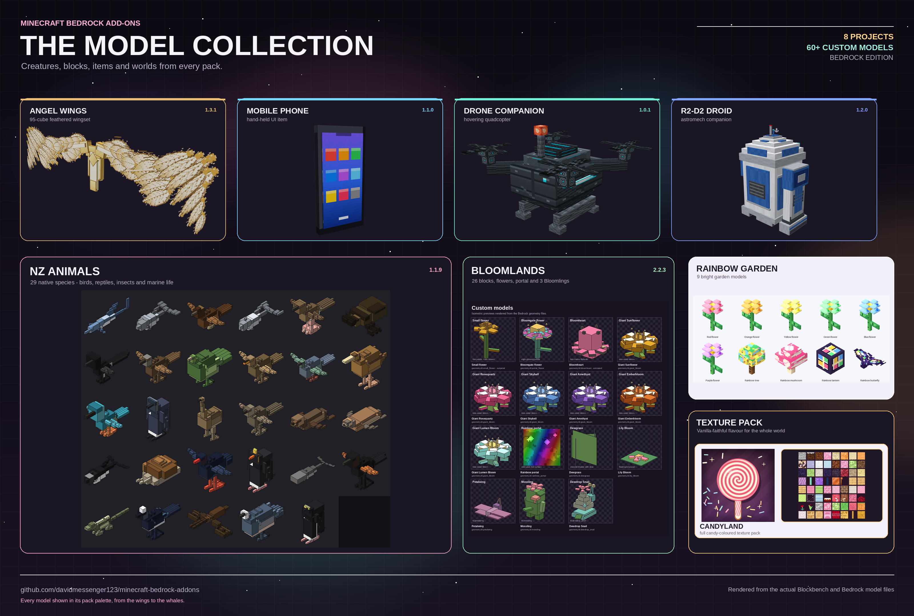

# Minecraft Bedrock Add-ons & Texture Packs

  

Eight add-ons and one texture pack for **Minecraft Bedrock Edition**:

| Project | Type | Version | Download |
| --- | --- | --- | --- |
| **Angel Wings** | Add-on | 1.3.1 | [AngelWings-1.3.1.mcaddon](angel-wings/AngelWings-1.3.1.mcaddon) |
| **Mobile Phone** | Add-on | 1.1.0 | [MobilePhone-1.1.0.mcaddon](mobile-phone/MobilePhone-1.1.0.mcaddon) |
| **Drone Companion** | Add-on | 1.0.1 | [DroneCompanion-1.0.1.mcaddon](drone-companion/DroneCompanion-1.0.1.mcaddon) |
| **NZ Animals** | Add-on | 1.1.9 | [NZ_Animals.mcaddon](nz-animals/NZ_Animals.mcaddon) |
| **Rainbow Garden** | Add-on | 1.0.1 | [RainbowGarden-1.0.1.mcaddon](rainbow-garden/RainbowGarden-1.0.1.mcaddon) |
| **Candyland** | Texture pack | 1.0.2 | [Candyland-v1.0.2.mcpack](candyland/dist/Candyland-v1.0.2.mcpack) |
| **R2-D2 Droid** | Add-on | 1.2.0 | [R2D2-1.2.0.mcaddon](r2-d2/R2D2-1.2.0.mcaddon) |
| **Bloomlands** | Add-on | 2.2.3 | [Bloomlands-2.2.3.mcaddon](bloomlands/Bloomlands-2.2.3.mcaddon) |
| **Cogworks** | Add-on | 1.5.0 | [Cogworks-1.5.0.mcaddon](cogworks/Cogworks-1.5.0.mcaddon) |

## Install

1. Download the `.mcaddon` or `.mcpack` file you want.
2. Open it with Minecraft Bedrock (double-click it, or use **Open with → Minecraft**).
   An `.mcaddon` imports its behavior and resource packs together; an `.mcpack`
   imports a resource pack.
3. Enable the packs for your world under **Settings → World → Behavior Packs** and
   **Resource Packs** (or Global Resources). The Candyland texture pack is
   activated under **Resource Packs** or **Global Resources**.
4. No experiments are required. The scripted add-ons use stable Script API
   2.0.0 modules; if your build only exposes them behind **Beta APIs**, enable that
   experiment. Texture packs and the data-only add-ons have no Script API dependency.
5. Reload the world.

## Angel Wings

A chest-slot angel-wing item with momentum-preserving, elytra-style flight.

- Item: `mod:angel_wings`
- Get it with `/give @s mod:angel_wings`, then equip it in the chest armor slot.
- Jump once to leave the ground, then jump again while airborne to deploy the wings.
- Hold jump to flap: each flap adds lift and a small forward boost.
- Look up/down to trade speed for height or height for speed; W/A/S/D gives air control.
- Sneak to fold the wings and fall normally.
- 432 durability, repaired with phantom membranes (one point per second of flight).
- 55-unit-wide, 95-cube layered feather model with an ivory/gold leading arm,
  fanned coverts, staggered primaries and a 128×128 cut-out atlas, rendered on
  the player's back through an attachable with grounded/airborne/flap animations.

See [angel-wings/README.md](angel-wings/README.md) for the full controls, model details,
and Blockbench source.

## Mobile Phone

A hand-held phone item with a 3D model and a form-based phone UI for running admin commands.

- Item: `phone:mobile_phone`
- Craft it with glass panes, redstone, iron, and an amethyst shard (see the phone README).
- Right-click while holding it to open the phone screen.
- Commands run as the player, so Bedrock's own permission system decides who can use them.

See [mobile-phone/README.md](mobile-phone/README.md) for the recipe, apps, and model details.

## Drone Companion

A summonable quadcopter companion with a controller item and a form-based order menu.

- Item: `drone:controller`
- Craft it with iron, redstone, copper, amethyst, and an ender pearl (see the drone README).
- Use the controller to summon your drone and open its menu.
- Orders: **Follow**, **Stay**, **Come**, **Scan**, **Light**, and **Defend**.
- Scan highlights nearby monsters; Light places a level-15 light block; Defend zaps the nearest monster.
- The drone is script-driven and hovers near you. It has no inventory or chest.

See [drone-companion/README.md](drone-companion/README.md) for the recipe, controls, model details, and Blockbench source.

## NZ Animals

29 New Zealand native species — birds, penguins, a tuatara, a weta, a huhu,
a Powelliphanta snail, seals and marine mammals — with custom models,
textures, spawn rules, animations and Creative spawn eggs.

- 29 species under the `nza:` namespace.
- Shared archetype builders give every species jointed wings and feathers,
  seal and penguin flippers, segmented swimmer bodies, six insect legs, and a
  flat spiral-disc snail shell.
- Per-profile walk and idle animations; collision boxes are body-only.
- Requires Bedrock **1.21.130+**.
- Summon with `/summon nza:kiwi`, or use the spawn eggs in the Creative inventory.

See [nz-animals/README.md](nz-animals/README.md) for the full roster,
measurements, model notes and build instructions. The
[contact sheet](nz-animals/preview/_contact_sheet.png) shows all 29 models.

## Rainbow Garden

A gentle, data-only garden add-on designed for a 4-year-old and adult co-play.
Magic seeds instantly grow giant rainbow flowers, a rainbow tree and a giant
mushroom; a glowing lantern and invulnerable rainbow butterflies finish the scene.

- 6 giant flower colours, a rainbow tree, a rainbow mushroom and a rainbow lantern.
- 8 magic seed items that place fully grown plants instantly.
- A passive, invulnerable rainbow butterfly with a spawn egg and natural plains spawning.
- 9 simple recipes, plus `/function rainbow_garden/starter` for a one-command kit.
- No scripts, experiments, combat, failure states, chat hooks or external services.
- Requires Bedrock **1.21.130+**.

See [rainbow-garden/README.md](rainbow-garden/README.md) for installation,
controls, recipes, safety notes and build instructions. The
[contact sheet](rainbow-garden/preview/_contact_sheet.png) shows every model.

## Candyland

A complete candy-themed texture pack: peppermint stone, chocolate dirt, mint
leaves, strawberry mobs, lavender menus and sugar-crystal skies. Every runtime
colour texture in the Bedrock samples tree has a replacement.

- 5,091 vanilla colour textures replaced, plus 4 compatibility textures.
- 1,294 blocks, 916 items, 848 entity skins, 1,649 UI and 193 GUI textures;
  83 animated flipbooks.
- Blocks and items are rebuilt at 32×32; entities, UI, maps and other
  UV-sensitive assets keep their native resolution.
- Custom skies, weather, sun/moon phases, block-break cracks, flames, portals,
  paintings and original Marketplace promo art.
- Tint masks stay grayscale and the biome colour maps were rebuilt.
- Requires Bedrock **1.26.60+**.

See [candyland/README.md](candyland/README.md) for install instructions, the
full texture counts, design notes, validation results and rebuild commands.
The [block](candyland/previews/blocks.png) and
[item](candyland/previews/items.png) contact sheets show the visual style.

## Bloomlands

A 4×4 flower-bed portal into a peaceful custom flower dimension with five themed
regions plus the Bloomlands Edge and three detailed peaceful mobs.

- Use Bloomgate `bl:bloom_portal` on a **grass block**. It spreads the
  surrounding 4×4 flower bed and opens a flat 2×2 rainbow portal in the style
  of the Nether portal.
- Void dimension `bl:bloomlands`, script-built once into a 480-block floating
  garden island with rolling meadow, forest and garden ground and a saved return
  portal.
- Regions: Sunpetal Meadow, Whispering Canopy, Giant's Garden, Petal Hills,
  Mirror Pool and the Bloomlands Edge.
- Old-growth Whispering Canopy trees with thick 3×3/5×5 trunks, branch arms and
  overlapping crowns that close the sky over the forest floor.
- 26 custom blocks: seven small flowers, six giant blooms, Bloomwood, petal grass,
  paths, canopy leaves and the animated rainbow portal surface.
- Three peaceful Bloomlings: Petalwing, Mossling and Dewdrop Snail, each with a
  128×128 atlas, detailed geometry, animations and Creative spawn eggs.
- No hostile mobs: the biome omits the `monster` tag and a script sweep removes
  any vanilla hostile that appears.
- Requires Bedrock **1.26.60+** and stable Script API **2.0.0**.

See [bloomlands/README.md](bloomlands/README.md) for portal recipes, region
notes, controls, mob details and build instructions. The
[region map](bloomlands/previews/region_map.png) and
[portal diagram](bloomlands/previews/portal_layout.png) show the layout.

## Cogworks

A powered automation add-on: coal generators and batteries energise a cable
network, visible stacks ride conveyors through filters/splitters/mergers, an
automated assembler crafts, and a surveyor-defined quarry excavates all the way
to bedrock into expandable storage.

- 22 custom blocks: Coal Generator, Wind Turbine, Solar Panel, Water Wheel,
  Copper Cable, Battery Bank, Energy Meter, Conveyor Belt, Item Filter, Belt
  Splitter, Belt Merger, Storage Extractor, Storage Terminal, Storage Port,
  Electric Furnace, Crusher, Sawmill, Alloy Smelter, Crafting Assembler, Storage
  Core, Storage Extension and Quarry Controller.
- 7 custom items: Powered Drill, Powered Chainsaw, Cogworks Wrench, Quarry
  Surveyor, Cogwork Gear, Control Circuit and Electric Motor.
- All seven items have 3D Blockbench attachable models that render in the
  player's hand in first and third person.
- Coal generation is joined by wind, solar and water generation; batteries store
  5,000 E; the Energy Meter reports network totals.
- Item stacks are visible on belts. Filters, three-way splitters and mergers
  route them between machines; belt corners are selected automatically from
  adjacent connections, with no separate corner item.
- Storage Core holds 8 item stacks; each connected Storage Extension adds 8
  more. The storage form includes search. The Storage Terminal queues machine
  recipes from the network; the Storage Port bridges chests, barrels and
  hoppers.
- The Storage Extractor supports per-item filters, allow/deny modes and three
  priority levels.
- Data-driven recipes power the Electric Furnace, Crusher, Sawmill, Alloy
  Smelter and Crafting Assembler. Machines raise their status light and pulse
  when working, blocked or idle.
- Quarry Surveyor sets a 32×32 footprint; the quarry digs down to the dimension
  floor (bedrock in the Overworld), reports progress, filters outputs, supports
  Fortune/Silk Touch and loads its area while active.
- Powered Drill supports 1×1, 3×3 and 3×3×3 modes; Powered Chainsaw fells a
  connected tree; Cogworks Wrench rotates belts and logistics blocks.
- Requires Bedrock **1.26.60+** and stable Script API **2.0.0** with
  `@minecraft/server-ui` **2.0.0**.

See [cogworks/README.md](cogworks/README.md) for recipes, machine setup, storage
search, conveyor routing, quarry controls and build instructions. The
[block model sheet](cogworks/previews/models.png) shows all twenty-two blocks,
the [item model sheet](cogworks/previews/tools.png) shows all seven held items,
and the [belt shape sheet](cogworks/previews/belt_shapes.png) shows automatic
corner variants.

## R2-D2 Droid

A detailed R2-D2 style astromech droid companion with a 106-cube Blockbench
model, a 256×256 colour atlas, idle and move animations, a toggleable
holoprojector, and custom beep/chirp/whistle sounds.

- Spawnable droid that tames to and follows the nearest player.
- Layered dome, radar eye, status lights, holoprojector, antennas, vents,
  shoulder hubs and treaded feet.
- Idle dome scan plus a moving/rolling leg animation.
- Right-click the droid to toggle a cyan hologram: a rising particle beam and a
  star-map orb that follow the rotating dome.
- Fire-immune, knockback-resistant and pushable-proof.
- Custom sounds: `mob.r2d2.beep`, `mob.r2d2.chirp`, `mob.r2d2.whistle`,
  `mob.r2d2.holo_on`, `mob.r2d2.holo_off`.
- Requires Bedrock **1.21.90+** and stable Script API **2.0.0**.

See [r2-d2/README.md](r2-d2/README.md) for install notes, controls, model
details and the Blockbench source.

## Requirements

- Minecraft Bedrock **1.21.90 or newer** for Angel Wings, Mobile Phone, Drone
  Companion and R2-D2 Droid; **1.21.130 or newer** for NZ Animals and Rainbow
  Garden; **1.26.60 or newer** for Candyland, Bloomlands and Cogworks.
- The scripted add-ons use stable Script API **2.0.0** modules (no experiments
  required; enable **Beta APIs** only if your build exposes those modules behind it).
  NZ Animals and Rainbow Garden are data-only and have no Script API dependency.
- Angel Wings and Bloomlands use `@minecraft/server` **2.0.0**. If your game ships a
  newer 2.x module, update the version in the appropriate `behavior_pack/manifest.json`.
- Mobile Phone, Drone Companion and Cogworks declare `@minecraft/server` **2.0.0**
  and `@minecraft/server-ui` **2.0.0**. If your game ships newer 2.x modules, update
  the versions in their `behavior_pack/manifest.json` (or `behaviour_pack/` for the
  phone).

## Source layout

| Folder | Contents |
| --- | --- |
| `angel-wings/` | Angel Wings behavior/resource packs, `.mcaddon`, Blockbench model, geometry and texture generators |
| `mobile-phone/` | Mobile Phone behavior/resource packs, `.mcaddon`, `.mcpack` alternatives, Blockbench model |
| `drone-companion/` | Drone Companion behavior/resource packs, `.mcaddon`, Blockbench model, texture and validation tools |
| `nz-animals/` | NZ Animals behavior/resource packs, `.mcaddon`, model/animation generators, validators and preview renders |
| `rainbow-garden/` | Rainbow Garden behavior/resource packs, `.mcaddon`, content generators, validator and preview renders |
| `candyland/` | Candyland resource pack, `.mcpack`, full texture pipeline, validator and preview renders |
| `r2-d2/` | R2-D2 droid add-on, `.mcaddon`, Blockbench model, sounds and validation tools |
| `bloomlands/` | Bloomlands custom dimension add-on, `.mcaddon`, block/mob models, previews and build/validation tools |
| `cogworks/` | Cogworks automation add-on, `.mcaddon`, Blockbench block/item sources, model sheets and build/validation tools |

## Releases

- [Angel Wings 1.2.0](https://github.com/davidmessenger123/minecraft-bedrock-addons/releases/tag/angel-wings-v1.2.0)
- [Angel Wings 1.3.0](https://github.com/davidmessenger123/minecraft-bedrock-addons/releases/tag/angel-wings-v1.3.0)
- [Angel Wings 1.3.1](https://github.com/davidmessenger123/minecraft-bedrock-addons/releases/tag/angel-wings-v1.3.1)
- [Mobile Phone 1.1.0](https://github.com/davidmessenger123/minecraft-bedrock-addons/releases/tag/mobile-phone-v1.1.0)
- [Drone Companion 1.0.1](https://github.com/davidmessenger123/minecraft-bedrock-addons/releases/tag/drone-companion-v1.0.1)
- [NZ Animals 1.1.0](https://github.com/davidmessenger123/minecraft-bedrock-addons/releases/tag/nz-animals-v1.1.0)
- [NZ Animals 1.1.8](https://github.com/davidmessenger123/minecraft-bedrock-addons/releases/tag/nz-animals-v1.1.8)
- [NZ Animals 1.1.9](https://github.com/davidmessenger123/minecraft-bedrock-addons/releases/tag/nz-animals-v1.1.9)
- [Rainbow Garden 1.0.1](https://github.com/davidmessenger123/minecraft-bedrock-addons/releases/tag/rainbow-garden-v1.0.1)
- [Candyland 1.0.0](https://github.com/davidmessenger123/minecraft-bedrock-addons/releases/tag/candyland-v1.0.0)
- [Candyland 1.0.1](https://github.com/davidmessenger123/minecraft-bedrock-addons/releases/tag/candyland-v1.0.1)
- [Candyland 1.0.2](https://github.com/davidmessenger123/minecraft-bedrock-addons/releases/tag/candyland-v1.0.2)
- [R2-D2 Droid 1.0.0](https://github.com/davidmessenger123/minecraft-bedrock-addons/releases/tag/r2-d2-v1.0.0)
- [R2-D2 Droid 1.1.0](https://github.com/davidmessenger123/minecraft-bedrock-addons/releases/tag/r2-d2-v1.1.0)
- [R2-D2 Droid 1.2.0](https://github.com/davidmessenger123/minecraft-bedrock-addons/releases/tag/r2-d2-v1.2.0)
- [Bloomlands 1.0.0](https://github.com/davidmessenger123/minecraft-bedrock-addons/releases/tag/bloomlands-v1.0.0)
- [Bloomlands 2.0.0](https://github.com/davidmessenger123/minecraft-bedrock-addons/releases/tag/bloomlands-v2.0.0)
- [Bloomlands 2.1.0](https://github.com/davidmessenger123/minecraft-bedrock-addons/releases/tag/bloomlands-v2.1.0)
- [Bloomlands 2.2.0](https://github.com/davidmessenger123/minecraft-bedrock-addons/releases/tag/bloomlands-v2.2.0)
- [Bloomlands 2.2.1](https://github.com/davidmessenger123/minecraft-bedrock-addons/releases/tag/bloomlands-v2.2.1)
- [Bloomlands 2.2.2](https://github.com/davidmessenger123/minecraft-bedrock-addons/releases/tag/bloomlands-v2.2.2)
- [Bloomlands 2.2.3](https://github.com/davidmessenger123/minecraft-bedrock-addons/releases/tag/bloomlands-v2.2.3)
- [Cogworks 1.0.0](https://github.com/davidmessenger123/minecraft-bedrock-addons/releases/tag/cogworks-v1.0.0)
- [Cogworks 1.1.0](https://github.com/davidmessenger123/minecraft-bedrock-addons/releases/tag/cogworks-v1.1.0)
- [Cogworks 1.2.0](https://github.com/davidmessenger123/minecraft-bedrock-addons/releases/tag/cogworks-v1.2.0)
- [Cogworks 1.3.0](https://github.com/davidmessenger123/minecraft-bedrock-addons/releases/tag/cogworks-v1.3.0)
- [Cogworks 1.4.0](https://github.com/davidmessenger123/minecraft-bedrock-addons/releases/tag/cogworks-v1.4.0)
- [Cogworks 1.5.0](https://github.com/davidmessenger123/minecraft-bedrock-addons/releases/tag/cogworks-v1.5.0)
