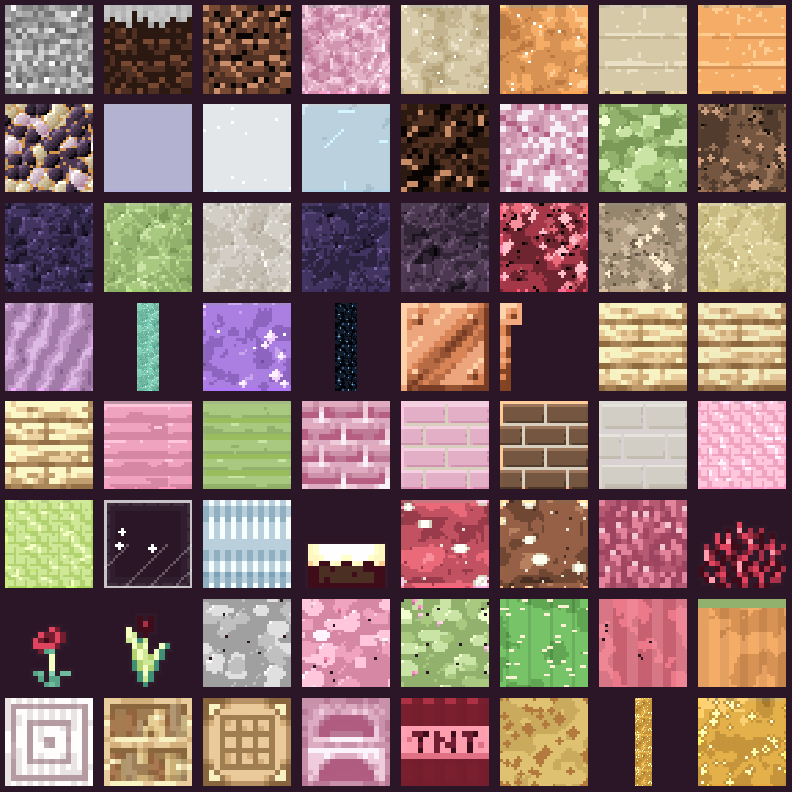
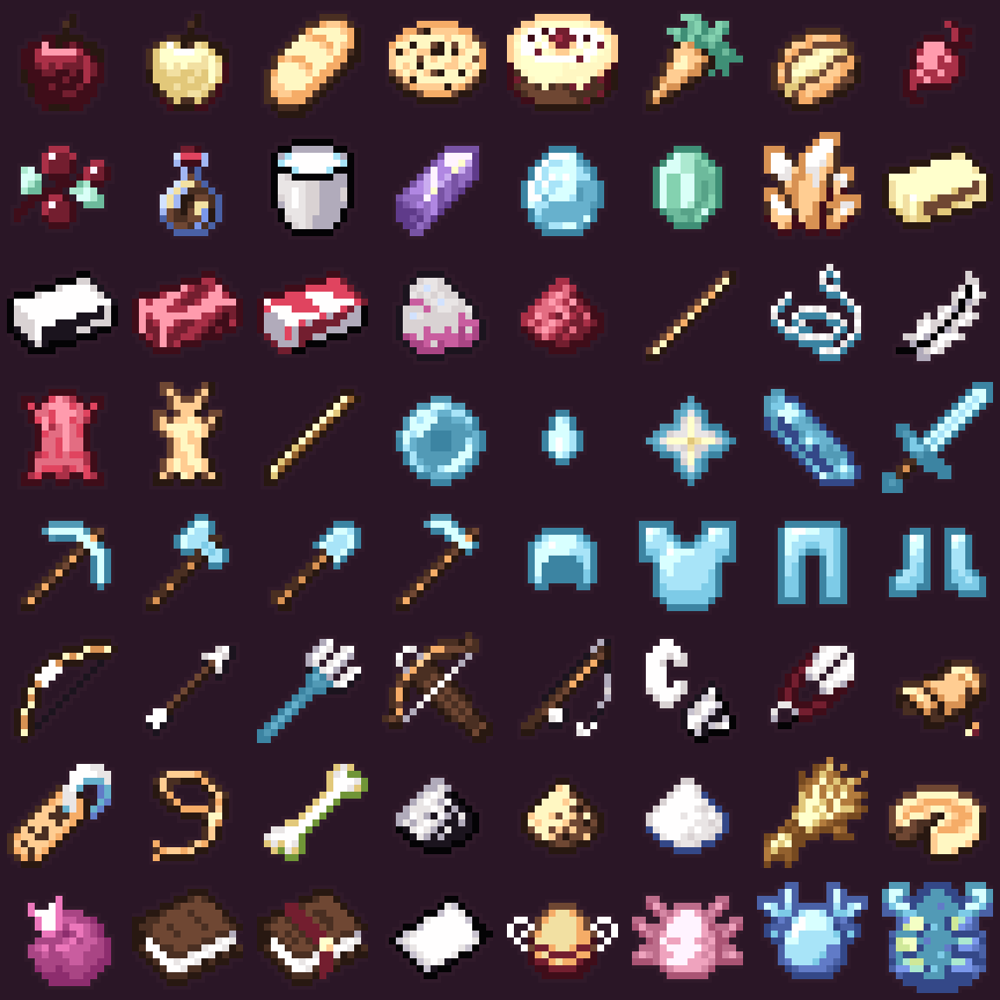

# Candyland

A complete **Minecraft Bedrock Edition** resource pack that turns the game into a
candy-coated world: peppermint stone, chocolate dirt, mint leaves, strawberry
mobs, lavender menus, sugar-crystal skies, and hand-drawn UI art.


## What is inside

| | |
|---|---|
| Source colour textures replaced | **5,085** |
| Compatibility textures added | **2** (`cake`, `camera`) |
| Generated images shipped | **5,087** |
| Blocks / items | 1,294 / 916 |
| Entity / UI / GUI | 848 / 1,643 / 193 |
| Trims / particles / models | 57 / 31 / 26 |
| Paintings / environment / maps | 22 / 18 / 16 |
| Colormaps / misc / atlases | 8 / 5 / 2 |
| Animated flipbooks | 83 |
| Pack size | **6.4 MB** / 6.1 MiB (`.mcpack`) |

Every runtime *colour* texture in the Bedrock samples tree is covered. The 3,134
PBR companion maps (`_mers`, normal maps, height maps) are intentionally not
included; this is a standard-rendering pack, not an RTX texture set.

| Blocks | Items |
|---|---|
|  |  |

More previews:

- [Mob skins](previews/entities.png)
- [UI and HUD art](previews/ui.png)
- [Sky, weather, sun, moon and effects](previews/environment.png)

## Install

### Windows 10/11, Android, iOS/iPadOS

1. Download **`dist/Candyland-v1.0.0.mcpack`**.
2. Open the `.mcpack` file with Minecraft. The game imports it automatically.
3. Go to **Settings → Global Resources → My Packs**, select **Candyland**, and
   activate it. For a specific world, use **World Settings → Resource Packs**.
4. If the pack is not visible in a world, check that the world is not requiring
   a different resource-pack set.

Manual install locations (useful if file association does not work):

- **Windows Bedrock:** `%localappdata%\Packages\Microsoft.MinecraftUWP_8wekyb3d8bbwe\LocalState\games\com.mojang\resource_packs`
- **Windows Preview:** the equivalent `Microsoft.MinecraftWindowsBeta_...` package folder
- **Android:** `Android/data/com.mojang.minecraftpe/files/games/com.mojang/resource_packs`
- **iOS/iPadOS:** use the Files app to share the `.mcpack` to Minecraft; direct
  filesystem access is restricted by the app sandbox.

`dist/Candyland-v1.0.0.zip` contains exactly the same files and can be unpacked
into `resource_packs` manually. Keep the folder name `Candyland` (or any name
you like) and make sure `manifest.json` is at its root.

Console versions generally do not have a one-click local file importer. Use the
platform's import feature if it is available, or transfer a world that already
has the pack applied. Availability varies by platform and game version.

## Design notes

- **Palette:** cream `#fff3dc`, bubblegum `#ff8fb3`, cherry `#ef5a74`, mint
  `#8fe3c0`, lemon `#ffe27a`, blueberry `#8fc7ff`, grape `#5b2f66`, plum
  `#2a1626`, chocolate and caramel shadows.
- **Six-tone ramps:** every material uses a discrete colour ramp rather than a
  smooth gradient. The result is crisp, toy-like pixel art that reads at both
  native and 2× resolution.
- **2× blocks and items:** 16 px block/item sources are rebuilt at 32×32.
  Animated block strips keep their frame layout. Entities, UI, GUI, maps and
  other UV-sensitive assets stay at their original resolution so skins and
  layouts do not break.
- **Tint-aware:** grass, leaves, vines, water masks and other runtime-tinted
  textures stay luminance masks; the `colormap/` assets were replaced with
  candy-tinted biome maps.
- **Custom environment:** puffy clouds, a candy sun, eight moon phases, weather
  atlas, chocolate block-break cracks, a 32-frame flame strip, End sky, portal
  colours, and sugar-noise forcefields.
- **Original promo slots:** the Marketplace sidebar and Realms store images are
  replaced with original lollipop badges and a candy landscape rather than
  derivative third-party art.
- **Atlas compatibility:** `terrain_texture.json`, `item_texture.json`,
  `flipbook_textures.json` and `texture_list.json` keep vanilla names and layout.
  Two stale pale-moss aliases in the sample config were pointed at the real
  texture names, and compatibility `blocks/cake.png` and `items/camera.png`
  assets were added for legacy entries that the samples do not include.

## Validation

The pack was checked with `tools/validate.py`:

- all 5,085 source colour bases have an inventory entry and an output image;
- every generated PNG/TGA/JPEG decodes and has the expected dimensions;
- all 3,275 texture references in the terrain and item atlases resolve;
- all 83 flipbook frame indices fit their vertical strips;
- the manifest UUIDs, module type, 256×256 icon and `.mcpack` archive are valid;
- result: **0 errors, 0 warnings**.

This is structural validation, not a live-client playtest. Back up a world before
activating any large resource pack, and test in a copy first if you are using it
with an existing survival world.

## Rebuild from source

The generators use only the Python standard library plus **ImageMagick 7** for
image inspection and a few JPEG/contact-sheet operations. The reference tree is
Mojang's `bedrock-samples` repository; it is not included in this project or in
the resource pack.

```bash
export BEDROCK_SAMPLES=/path/to/bedrock-samples/resource_pack

python3 tools/inventory.py       # scan source names/dimensions
python3 tools/build_blocks.py    # 1,294 block textures
python3 tools/build_items.py     # 916 item icons
python3 tools/build_rest.py      # entities, UI, GUI, trims, effects, ...
python3 tools/build_previews.py  # README contact sheets
python3 tools/build_pack.py      # icon, manifest, .mcpack, .zip
python3 tools/validate.py        # full structural check
```

`tools/build_pack.py` uses deterministic UUIDs derived from the pack identity,
so rebuilding version 1.0.0 produces the same manifest identity. Change
`VERSION` in that script for a new release.

## Layout

```text
candyland/
├── resource_pack/
│   ├── manifest.json
│   ├── pack_icon.png
│   ├── texts/en_US.lang
│   └── textures/
│       ├── terrain_texture.json
│       ├── item_texture.json
│       ├── flipbook_textures.json
│       ├── texture_list.json
│       ├── blocks/  items/  entity/  ui/  gui/  ...
│       └── colormap/
├── tools/            # generators, packager, validator, preview builder
├── build/            # inventory, problems, validation report
├── previews/         # README images
└── dist/
    ├── Candyland-v1.0.0.mcpack
    └── Candyland-v1.0.0.zip
```

## Notes and limitations

- **Bedrock only.** This pack uses Bedrock texture paths and the Bedrock manifest
  format; it is not a Java resource pack. It targets Bedrock **1.26.50** (the
  `min_engine_version` in the manifest); lower that value if you need to test it
  on an older client.
- **No PBR/RTX set.** Shader packs may still apply their own PBR materials; the
  colour art is designed for standard rendering.
- **UI layout is preserved.** Panels are re-themed, but button positions and
  nine-slice UV layouts are untouched so the HUD remains usable.
- **Tiny effects stay tiny.** One-pixel particles and some legacy 1×1 effects
  cannot carry much detail by design.
- **Legacy entries.** A few vanilla sample config entries refer to assets that
  are absent from the samples; compatibility assets and corrected paths are
  included where possible.

## Credits

Candyland is an unofficial fan project, not affiliated with Mojang or Microsoft.
Minecraft is a trademark of Mojang Synergies AB. The reference `bedrock-samples`
tree was used only for file names, dimensions, atlas keys and layout; every
shipped image is generated output from the Candyland pipeline. Please respect
Minecraft's EULA and do not redistribute Mojang's original assets.
