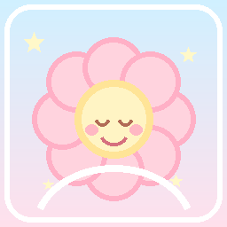
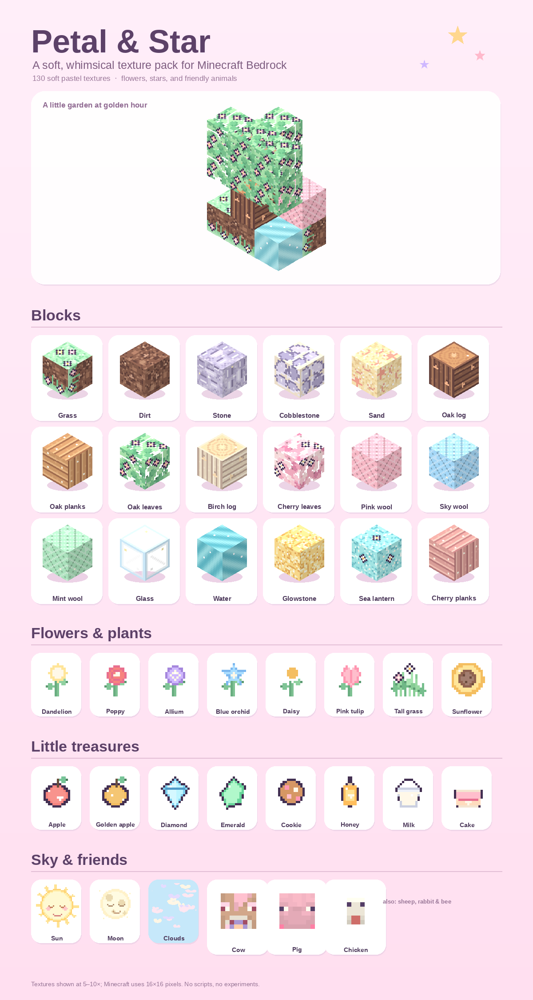

# Petal & Star

A soft, whimsical texture pack for **Minecraft Bedrock Edition**, made for a
four-year-old adventurer. It turns the Overworld into a pastel storybook
garden: minty grass, blossom-covered leaves, candy-coloured wool, smiling
skies, and friendly pastel animals.





## What's inside

**130 textures**, all painted to work together at Minecraft's 16×16 scale.

- **Ground & stone** — flowered grass, cocoa dirt, lavender stone, pastel
  cobblestone, and shell-dotted sand.
- **Trees** — oak, birch, spruce, jungle, acacia, dark oak, cherry, and
  mangrove logs, planks, and leaves, with tiny blossoms in the canopy.
- **Flowers & plants** — dandelion, poppy, allium, blue orchid, cornflower,
  oxeye daisy, four tulips, lily of the valley, azure bluet, peony, wither
  rose, sunflower, and tall grass.
- **Wool** — all 16 colours in soft pastel shades.
- **Glass, water & lights** — sparkly glass, gentle aqua water, a starry
  torch, a glowing lantern, glowstone, and sea lanterns.
- **Little treasures** — apples, golden apples, bread, cookies, eggs, gems,
  ingots, milk and water buckets, honey, wheat, carrots, potatoes, beetroot,
  sweet berries, books, paper, a flower pot, a candy-striped stick, a
  snowball, cake, and a pastel spawn egg.
- **Sky** — a smiling sun, sleepy moon phases, and fluffy pink-and-lavender
  clouds.
- **Friendly animals** — recoloured cow, pig, chicken, sheep, rabbit, and bee
  textures. Their UV layouts are unchanged, so the models still work exactly
  as normal.

## Design notes

- Soft pastels, rounded shapes, and warm cocoa outlines instead of harsh
  black ones.
- No flashing, strobing, or high-contrast flicker effects.
- No scary faces, blood, or horror imagery added.
- Texture-only: no scripts, no behaviour changes, no sounds, no UI changes,
  and no experiments.
- **Hostile mobs, fire, and lava are not changed.** Danger stays visually
  obvious. For a gentle world, play on Peaceful or Creative difficulty. The
  pack makes the world prettier, not safer.

## Install

1. Download `PetalAndStar-1.0.0.mcpack`.
2. Open the file with Minecraft. On Windows, double-click it; on mobile, use
   **Open with → Minecraft**.
3. In Minecraft, open **Settings → Global Resources** (or a world's
   **Resource Packs** tab) and activate **Petal & Star**.
4. Put it at the top of the active resource-pack list so it overrides other
   texture packs.

The pack is a resource pack, not an add-on. It can be used with other resource
packs and add-ons, but it should load after any pack whose block or item
textures it should replace.

## Compatibility

- Minecraft Bedrock Edition **1.21+**.
- No experimental toggles are required.
- The manifest uses `min_engine_version` 1.21.0 and one `resources` module.
- This build was validated structurally offline (manifest, texture sizes,
  alpha cutouts, deterministic output, and archive integrity). It has not been
  run on a live Bedrock client, so a quick in-game look is recommended before
  publishing.

## Build

```bash
python3 -m pip install -r tools/requirements.txt
python3 tools/generate.py
python3 tools/validate.py
python3 tools/preview.py
```

Outputs:

- `resource_pack/` — the unpacked resource pack.
- `PetalAndStar-1.0.0.mcpack` — the installable archive.
- `preview/_contact_sheet.png` — the preview sheet above.
- `preview/hero.png` — a small isometric garden scene.
- `preview/pack_icon.png` — a copy of the pack icon for the README.

The generator is deterministic: rebuilding produces the same textures. The
only borrowed source art is the small set of vanilla entity atlases in
`tools/vanilla_entity/`, which are recoloured rather than shipped unmodified.

## Files

```text
petal-and-star/
├── PetalAndStar-1.0.0.mcpack
├── resource_pack/
│   ├── manifest.json
│   ├── pack_icon.png
│   └── textures/
├── tools/
│   ├── content.py
│   ├── generate.py
│   ├── validate.py
│   ├── preview.py
│   ├── VERSION
│   ├── requirements.txt
│   └── vanilla_entity/
└── preview/
```

## Credits

Petal & Star is an unofficial fan project, not affiliated with Mojang or
Microsoft. Minecraft is a trademark of Mojang Synergies AB. The build scripts
and original textures are available under the MIT licence; the recoloured
vanilla entity atlases remain Mojang's assets and are included only so the
pack can override them inside Minecraft.
