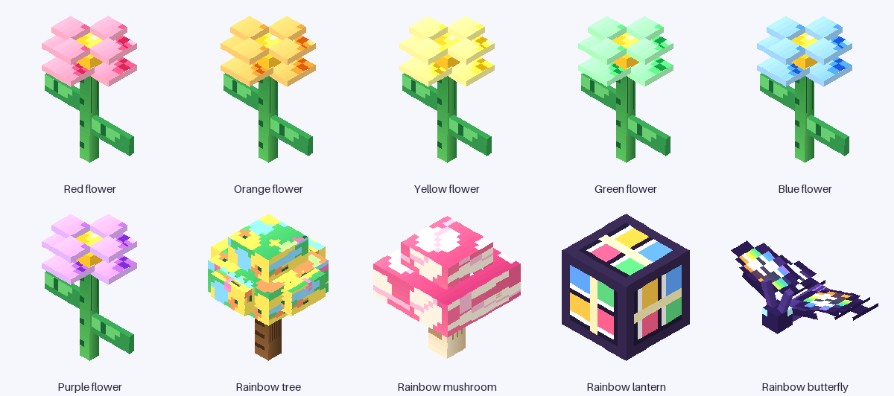

# Rainbow Garden

A gentle Minecraft Bedrock add-on for young children: magic seeds instantly grow giant rainbow flowers, a glowing rainbow tree, and a giant mushroom. Rainbow butterflies drift through the garden, and a rainbow lantern lights it up.



## Made for a 4-year-old

Rainbow Garden is designed around short, successful play sessions rather than reading or combat:

- **Instant results.** A seed becomes a fully grown, giant flower the moment it is placed. Nothing has to grow, and nothing can fail.
- **Big, clear targets.** Flowers, trees, mushrooms and the lantern are large models with generous selection boxes.
- **No danger.** The butterfly is invulnerable and never attacks. There are no hostile mobs, drops, timers, or death states in this pack.
- **Colour and light.** Six flower colours, rainbow leaves, a glowing lantern, colourful break particles, and a rainbow-winged butterfly provide immediate visual feedback.
- **Gentle senses.** The pack uses soft vanilla grass/wood/glass sounds and static glow. There are no flashing lights, loud custom sounds, jump-scares, chat messages, links, purchases, or external services.
- **Parent co-play.** An adult can set up a garden in Creative mode and hand over a few seeds. The child can then place, swap colours, and watch butterflies.

## What is in the garden?

| Thing | Details |
| --- | --- |
| **6 giant rainbow flowers** | Red, orange, yellow, green, blue and purple. Each is a tall, layered 3D flower that glows faintly. |
| **Rainbow tree** | A 30-pixel-tall magical tree with rainbow leaves and little pink fruit. |
| **Rainbow mushroom** | A giant pink-spotted mushroom with a cream stem. |
| **Rainbow lantern** | A full-brightness decorative lamp with four coloured panes. |
| **Rainbow butterfly** | A passive, invulnerable butterfly with rainbow wings that flutters around the garden. It can be summoned, spawned with its spawn egg, or found naturally in flower forests and plains. |
| **8 magic seed items** | Six flower seeds, one tree seed, and one mushroom seed. Each seed places its plant instantly. |

## Install

1. Download **`RainbowGarden-1.0.1.mcaddon`** from this folder.
2. Open it with Minecraft Bedrock (double-click it, or use **Open with → Minecraft**). It imports both the behaviour and resource packs together.
3. Enable **both** packs for the world under **Settings → World → Behaviour Packs** and **Resource Packs**.
4. No experiments are required.

The pack is data-only: it has no scripts, no `@minecraft/server` dependency, and no experimental toggles.

## Quick start for a parent

1. Create or open a Creative world (a flat garden world works well).
2. Turn on cheats if you want the one-command starter kit, then run:

   ```mcfunction
   /function rainbow_garden/starter
   ```

   This gives a stack of every seed, some tree and mushroom seeds, lanterns, and summons one butterfly.

3. Open the **Nature** tab in the Creative inventory if you prefer to pick items visually. The seeds have flower icons; the butterfly has its own spawn egg.
4. Place seeds on the ground. Each one instantly becomes a giant plant.
5. Put down a few lanterns, summon two or three butterflies, and let the child rearrange the garden.

## A five-minute garden

1. Find a flat patch of grass and put a rainbow lantern in the middle.
2. Place six different flower seeds around it like a clock face.
3. Add one rainbow tree and one mushroom at the edge.
4. Summon two or three butterflies.
5. Let the child swap colours, make a flower path, or rebuild the garden somewhere else. Nothing can be broken permanently.

## Commands

```mcfunction
# Give individual seeds
/give @s rg:rainbow_seed_red 16
/give @s rg:rainbow_seed_orange 16
/give @s rg:rainbow_seed_yellow 16
/give @s rg:rainbow_seed_green 16
/give @s rg:rainbow_seed_blue 16
/give @s rg:rainbow_seed_purple 16

# Tree, mushroom and lantern
/give @s rg:rainbow_tree_seed 4
/give @s rg:rainbow_mushroom_seed 4
/give @s rg:rainbow_lantern 8

# A butterfly (the spawn egg is also in the Nature tab)
/summon rg:rainbow_butterfly
```

## Optional crafting

Creative mode is the easiest way to play. For a survival world, simple recipes are included:

| Recipe | Ingredients | Result |
| --- | --- | --- |
| Colour seed | 1 matching dye + 1 wheat seeds | 4 colour seeds |
| Rainbow tree seed | red, orange, yellow and green flower seeds + 1 oak sapling | 1 tree seed |
| Rainbow mushroom seed | 1 red flower seed + 1 purple flower seed + 1 red mushroom | 1 mushroom seed |
| Rainbow lantern | 4 glass + 1 glowstone dust in a plus shape | 1 lantern |

## Requirements

- Minecraft Bedrock Edition **1.21.130 or newer**.
- Both the behaviour pack and resource pack enabled.
- No experiments.
- Works in Creative and Survival; Creative is recommended for young children.

## Safety and sensory notes

- No scripts, chat hooks, web requests, purchases, or external services.
- No hostile mobs, weapons, damage, death, or failure states.
- The butterfly is damage-proof and persistent; it cannot be hurt or killed by normal play.
- Block sounds use soft vanilla grass, wood and glass events. The lantern is a static light source, not a flashing effect.
- The pack is intended for co-play with an adult. Item names are in English, but every seed has a distinct flower icon and the blocks are visually distinct, so reading is not required to play.

## Build from source

Requirements: Python 3.10+ and Pillow.

```bash
python3 -m pip install -r tools/requirements.txt
python3 tools/generate.py   # writes behavior_pack/, resource_pack/ and the .mcaddon
python3 tools/validate.py   # resolves IDs, textures, geometry, recipes and language keys
python3 tools/preview.py    # writes preview/*.png and the contact sheet
```

The version is read from `tools/VERSION`. Change it there to produce a differently named artifact.

## Project layout

```text
rainbow-garden/
├── README.md
├── RainbowGarden-1.0.1.mcaddon
├── behavior_pack/
├── resource_pack/
├── preview/
│   ├── _contact_sheet.png
│   └── *.png
└── tools/
    ├── VERSION
    ├── requirements.txt
    ├── content.py      # models, textures and content roster
    ├── generate.py     # pack/JSON generation and packaging
    ├── validate.py     # structural/asset validator
    └── preview.py      # offline isometric previews
```

## Validation notes

`tools/validate.py` checks the pack manifests, UUIDs, identifiers, block-model limits, selection boxes, UV bounds, texture references, item icons, recipes, entity/client entity links, animation bones, language keys and the final `.mcaddon` archive. The previews are rendered offline from the same geometry and textures; they are a shape/colour check, not an in-game screenshot. Test the pack in a copy of a world before using it in a world you care about.

## License

MIT. See `LICENSE`.
